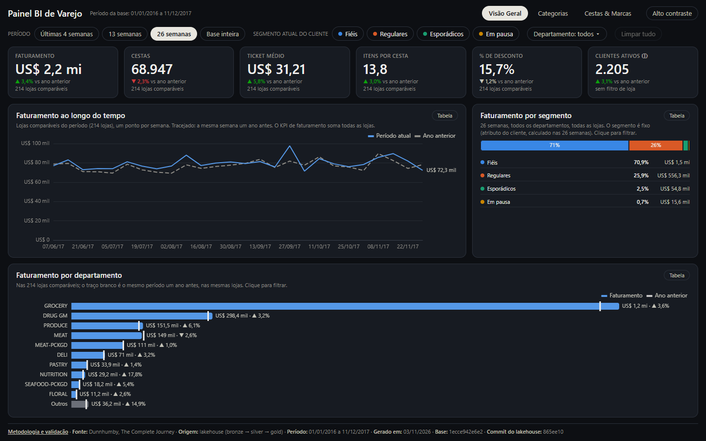
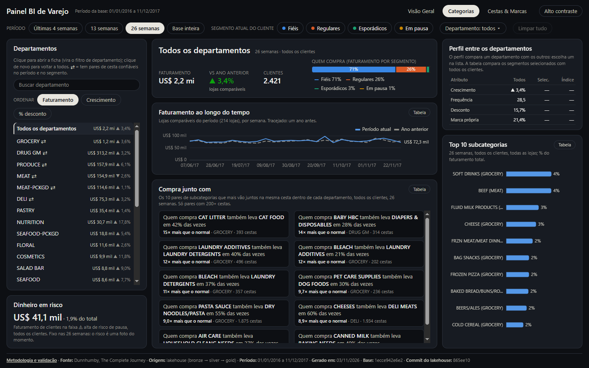
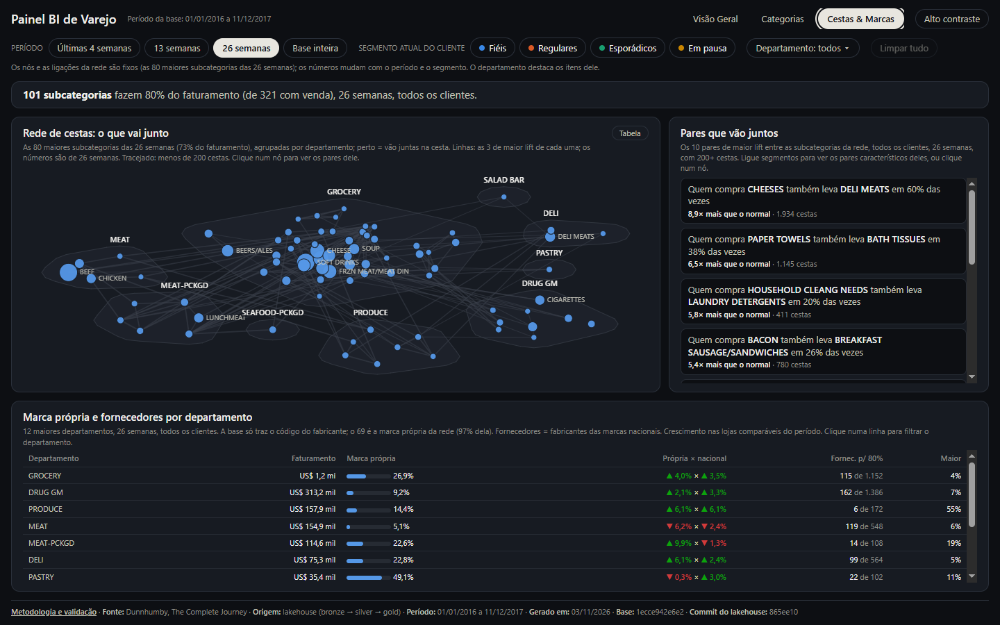
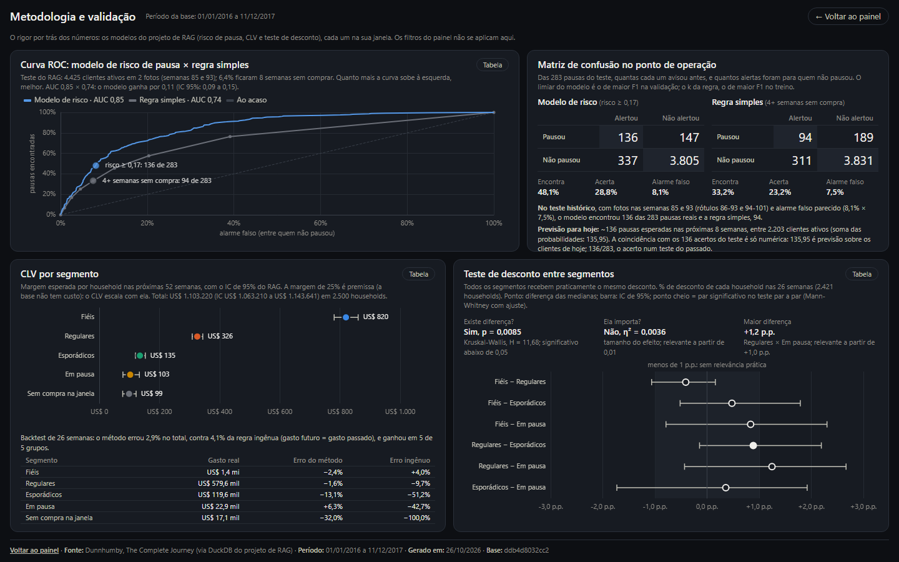
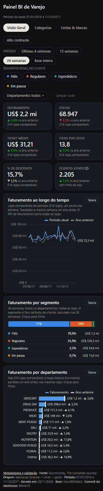

# Painel BI de Varejo (Dunnhumby)

**Abrir o painel:** https://caiosantosho2-dotcom.github.io/retail-bi-dashboard/

Painel de BI em uma página web, tema claro, com 3 abas (Visão Geral, Categorias e Cestas & Marcas) e uma página de
metodologia, com filtros globais e clique que filtra, como no Power BI. O painel é **consumidor de um lakehouse**: ele lê
JSONs com contrato e não faz a conta dos números. Os modelos vieram do projeto "Assistente Comercial + Análise de Clientes"
(projeto de RAG) e foram conferidos. O escopo desta versão está em [`docs/spec_painel_v4.md`](docs/spec_painel_v4.md).



## O que tem em cada aba

| Aba | Para quem | O que mostra |
|---|---|---|
| **Visão Geral** | diretoria e gerência | 6 KPIs com a variação contra o ano anterior nas lojas comparáveis (*like-for-like*), o faturamento ao longo do período selecionado com o ano anterior tracejado, o faturamento por segmento, **quem o CRM deve acionar** com capacidade para N clientes (dois objetivos, comparados com a regra simples no teste), **onde agir no mix** (dispersão de participação × crescimento, com 4 quadrantes e 3 departamentos para defender primeiro) e os departamentos com o traço do ano anterior |
| **Categorias** | comercial e category management | "Todos os departamentos" ou a ficha de um: faturamento, variação, clientes e quem compra por segmento, o faturamento ao longo do período, **o que se compra junto** (pares de subcategorias em frases: "Quem compra A também leva B em X% das vezes"), o perfil contra os outros departamentos, as 10 maiores subcategorias e o dinheiro em risco |
| **Cestas & Marcas** | comercial e category management | quantas subcategorias fazem 80% do faturamento, a **rede de cestas** das 80 maiores subcategorias (clicar num nó mostra com o que ele vai junto), os pares que cada segmento compra junto bem mais que a média, e a marca própria e a concentração de fornecedores por departamento |
| **Metodologia e validação** (link no rodapé) | quem quer ver o rigor | a curva ROC do modelo de risco de pausa contra a regra simples, a matriz de confusão, o CLV por segmento com o backtest e o teste de desconto entre segmentos |

**O gráfico de tempo** mostra só o período selecionado: um ponto por dia em 4 semanas e um por semana em 13, 26 semanas e
na base inteira. Em 4, 13 e 26 semanas, a linha é das lojas comparáveis do período, com o ano anterior tracejado. Por isso
a soma da linha dá menos que o KPI de faturamento, que conta todas as lojas. Na base inteira, a linha é de todas as lojas
e não há ano anterior.

Os filtros de período (4, 13 e 26 semanas ou a base inteira), segmento e departamento ficam numa barra lateral (no celular,
num painel aberto pelo botão "Filtros") e valem em todas as abas onde fazem sentido; quando um não se aplica, a aba diz por quê. A seleção funciona igual em todo gráfico que filtra: clicar filtra,
clicar de novo desfaz, Ctrl + clique soma, e Esc ou um clique no fundo vazio limpa.

**Cada card** tem título, no máximo um subtítulo curto e um ⓘ ao lado do título com o método, as regras e as dicas de
clique (abre com o mouse, com toque e com o teclado; Esc fecha). O card não repete os filtros, que já estão na barra
lateral. O que muda a leitura do número aparece como etiqueta curta ao lado do título ("123 lojas comparáveis",
"⚠ poucos pares no período", "todos os clientes"). O texto completo de cada método continua na página de metodologia.

**Onde agir no mix** marca no gráfico os 3 destaques só com o número (1, 2, 3), porque os nomes estão na lista "Defender
primeiro" ao lado; o departamento selecionado leva o nome, e os outros pontos têm tooltip. O bloco não mostra gráfico quando o recorte é só "Em pausa": o segmento é definido por ter parado de comprar,
então o crescimento cai por construção. Com "Em pausa" junto de outros segmentos, o bloco mostra uma etiqueta de aviso. A Visão Geral é a
única aba que rola a página em 1440×900.

| Categorias | Cestas & Marcas |
|---|---|
|  |  |

| Metodologia e validação | Celular |
|---|---|
|  |  |

## Arquitetura

```
CSV da Dunnhumby → lakehouse (bronze → silver → gold) → JSON com contrato → este painel
```

O lakehouse é um projeto separado, em Delta Lake: [retail-lakehouse](https://github.com/caiosantosho2-dotcom/retail-lakehouse). É lá que moram a
limpeza, as métricas, os modelos e a conferência. Este repositório cuida só de levar os dados para o site e de mostrá-los.

## Rigor

Nenhum número é escrito à mão nem calculado no navegador além de somas do que soma (faturamento, desconto).

- **Uma definição por métrica:** cada métrica é definida uma vez, na gold do lakehouse. Se faltar um número no painel, ele
  nasce lá, nunca aqui.
- **Conferência no lakehouse:** a exportação foi comparada, linha a linha, com o painel anterior, calculado por outro
  caminho a partir do projeto de RAG: 54.130 de 54.131 linhas iguais, e a única diferença é um texto, registrado e
  explicado. A etapa também refaz os períodos por um segundo caminho e confere 20 gabaritos.
- **Contrato de dados:** cada JSON tem schema em [`contracts/`](contracts/), grão declarado e hash no `manifest.json`.
  [`scripts/importar_lakehouse.py`](scripts/importar_lakehouse.py) valida tudo antes de copiar e, se algo falhar, não toca
  em `site/data/` ([`tests/test_importar_lakehouse.py`](tests/test_importar_lakehouse.py)).
- **Procedência:** o rodapé mostra a origem, a base e o commit do lakehouse usados, lidos do `manifest.json`.
- **Seleção:** os 4 gestos (clique, clique de novo, Ctrl + clique, Esc) são testados por clique real do mouse em todos os
  gráficos clicáveis ([`tests/gestos.js`](tests/gestos.js)).
- **Publicação:** um cenário de controle reproduz o erro de cache sem a pasta versionada, e outros 4 provam que, com ela, a
  página fica inteira numa versão só ([`tests/cache_cenarios.js`](tests/cache_cenarios.js)).
- **Tela:** cada fase foi aberta no navegador (Playwright) em 1440×900 e 390×844, com os números da tela comparados aos
  JSONs. Os relatórios ficam em [`docs/validacao/`](docs/validacao/).

## Rodar localmente

O site é estático e roda sozinho com os JSONs já importados em `site/data/`, sem banco nem lakehouse:

```
python -m http.server 8000 --directory site
```

e abra `http://localhost:8000` (não por `file://`: o `fetch` dos JSONs falha nele). A publicação no GitHub Pages é
feita pelo workflow [`.github/workflows/pages.yml`](.github/workflows/pages.yml) a cada mudança em `site/` na `main`. O
workflow roda [`scripts/versionar_site.py`](scripts/versionar_site.py), que põe JS e CSS numa pasta com o hash do conteúdo,
para quem tem cache antigo não misturar versões. Localmente, esse passo não é necessário.

## Regenerar os dados

**Exige o projeto do lakehouse.** O site publicado não precisa dele.

1. No lakehouse, rode o pipeline, que vai da bronze à exportação e à conferência:

   ```
   python -m src.pipeline
   ```

2. Neste repositório, copie `config.example.yaml` para `config.yaml` (fora do git) e preencha `lakehouse_export`.
3. Crie o ambiente: `python -m venv venv` e `venv\Scripts\pip install -r requirements.txt`.
4. Importe:

   ```
   venv\Scripts\python scripts\importar_lakehouse.py
   ```

O importador confere a versão do contrato (5.1), valida cada JSON e confere bytes e sha256 contra o manifest. Só depois troca
`site/data/` e mostra um resumo: arquivos copiados e removidos, bytes da abertura, base e commit do lakehouse. Ele avisa se a
exportação veio de um estado sem commit. Importar não prova que a conta está certa: isso quem confere é o pipeline.

## O que a base não tem

- **Encarte e ponta de gôndola** (`causal_data`): existem na base, mas ficam para uma fase futura.
- **Share de gôndola e ruptura:** não existem na base Dunnhumby. O painel não mostra nem estima esses indicadores.
- **Calendário real:** as datas são inventadas, então o painel não mostra dia da semana, feriados nem sazonalidade de calendário.

## Dados

Base pública Dunnhumby, *The Complete Journey*: 2.500 domicílios, 2 anos de compras. O painel mostra só agregados e não usa
demografia.

## Estado

Painel v4 pronto na branch `v4-lakehouse`, ainda não publicado: o site no ar continua sendo o redesenho v3, com 4 abas e o
pipeline antigo (guardado na tag `v3-rag`). O que mudou e por quê está em
[`docs/mudancas/resumo_v4.md`](docs/mudancas/resumo_v4.md), e a validação em
[`docs/validacao/painel_v4.md`](docs/validacao/painel_v4.md).

**v4.1, na branch `v4-1-decisao`, validada no navegador e ainda não publicada:** os dois blocos de decisão na Visão Geral. O que mudou está em
[`docs/mudancas/resumo_v4_1.md`](docs/mudancas/resumo_v4_1.md), e a validação em
[`docs/validacao/v4_1_painel.md`](docs/validacao/v4_1_painel.md).

**v4.2, ajuste visual:** tema claro, nova paleta, fonte maior, filtros na barra lateral e textos dos cards enxutos (subtítulo
curto + ⓘ). Nenhum dado mudou. O que mudou está em [`docs/mudancas/resumo_v4_2.md`](docs/mudancas/resumo_v4_2.md), e a
validação em [`docs/validacao/v4_2_visual.md`](docs/validacao/v4_2_visual.md). As capturas acima ainda são do tema escuro
(v4.1): serão refeitas depois da conferência visual.

Fase futura, fora do escopo atual: os dados de encarte e ponta de gôndola (`causal_data`).
