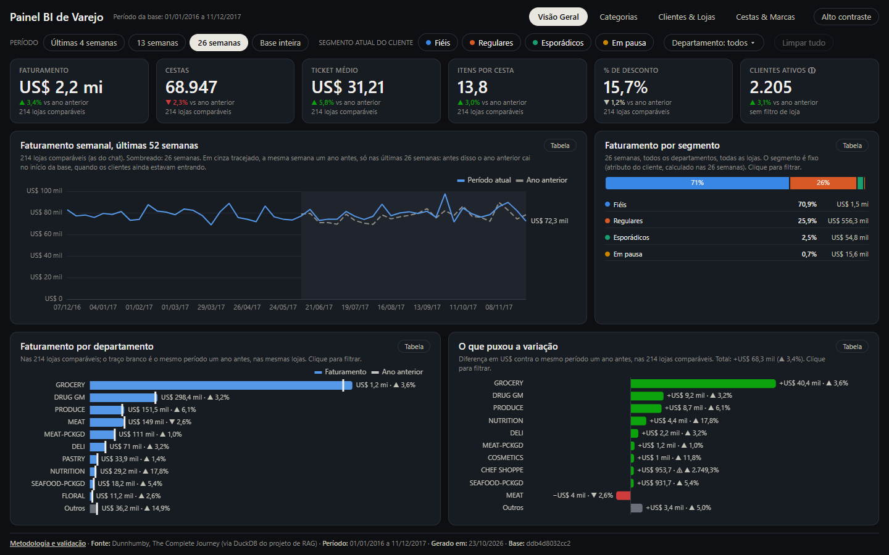
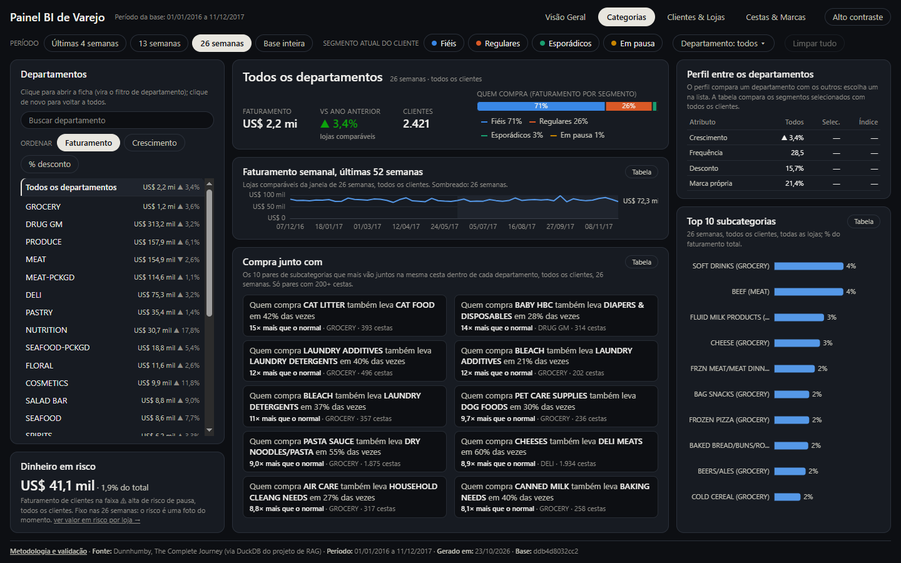
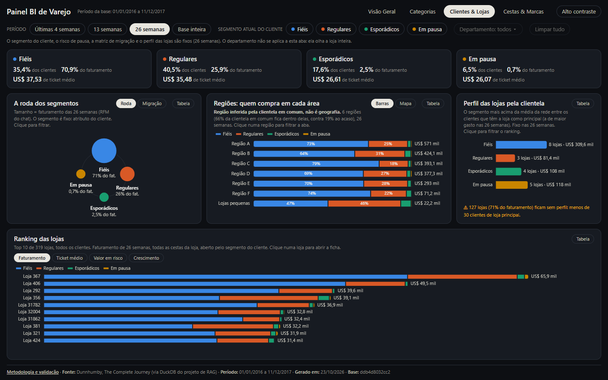
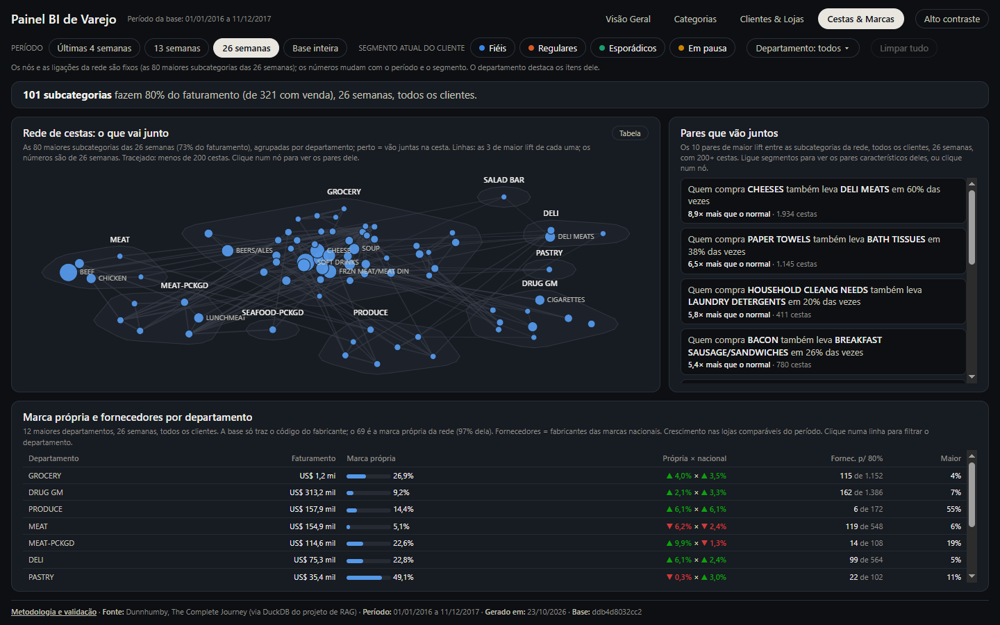
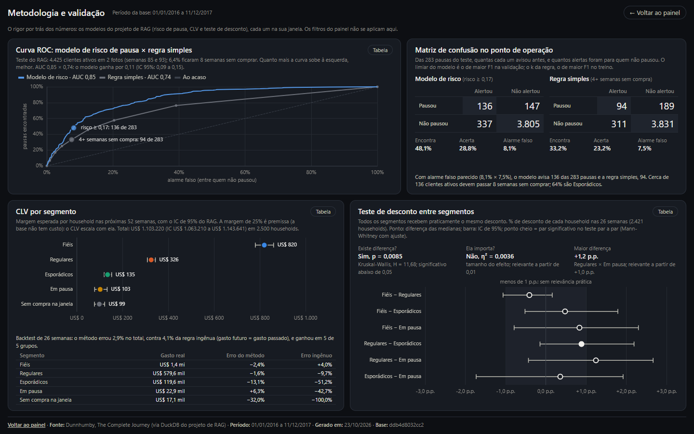
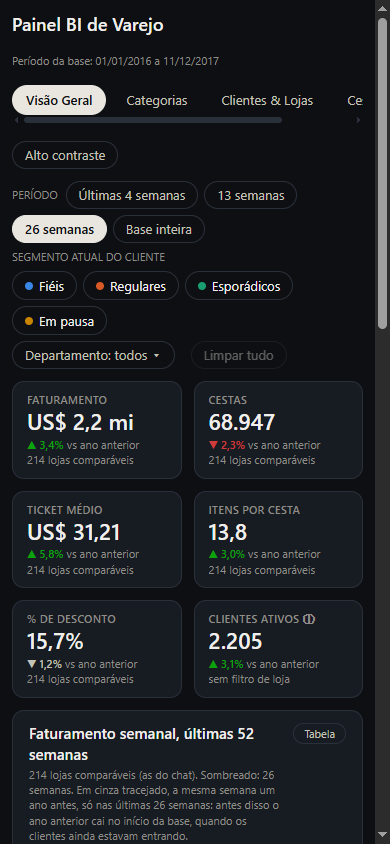

# Painel BI de Varejo (Dunnhumby)

**Abrir o painel:** https://caiosantosho2-dotcom.github.io/retail-bi-dashboard/

Painel de BI em uma página web, tema escuro, com 4 abas (Visão Geral, Categorias, Clientes & Lojas e Cestas & Marcas)
e uma página de metodologia, com filtros globais e clique que filtra, como no Power BI. É a continuação visual do projeto "Assistente
Comercial + Análise de Clientes" (projeto de RAG): painel e chat usam as mesmas definições e dão o mesmo número para a
mesma pergunta. As regras estão em [`docs/spec_dashboard.md`](docs/spec_dashboard.md).



## O que tem em cada aba

| Aba | Para quem | O que mostra |
|---|---|---|
| **Visão Geral** | diretoria e gerência | 6 KPIs com a variação contra o ano anterior nas lojas comparáveis (*like-for-like*), faturamento semanal das últimas 52 semanas com o período sombreado, faturamento por segmento, departamentos com o traço do ano anterior e **o que puxou a variação** (a contribuição de cada departamento) |
| **Categorias** | comercial e category management | "Todos os departamentos" ou a ficha de um: faturamento, variação, clientes e quem compra por segmento, o faturamento semanal, **o que se compra junto** (pares de subcategorias em frases: "Quem compra A também leva B em X% das vezes"), o perfil contra os outros departamentos, as 10 maiores subcategorias e o dinheiro em risco |
| **Clientes & Lojas** | CRM, marketing e operações | os 4 segmentos (Fiéis, Regulares, Esporádicos, Em pausa) com a Roda e a **matriz de migração**, as regiões e quem compra em cada uma (inferidas pela clientela em comum: o painel avisa que não é geografia), o perfil das lojas, o ranking por faturamento, ticket, valor em risco ou crescimento, e a **ficha da loja** ao lado, com a lista dos clientes em risco e "Baixar CSV" |
| **Cestas & Marcas** | comercial e category management | quantas subcategorias fazem 80% do faturamento, a **rede de cestas** das 80 maiores subcategorias (clicar num nó mostra com o que ele vai junto), os pares que cada segmento compra junto bem mais que a média, e a marca própria e a concentração de fornecedores por departamento |
| **Metodologia e validação** (link no rodapé) | quem quer ver o rigor | a curva ROC do modelo de risco de pausa contra a regra simples, a matriz de confusão, o CLV por segmento com o backtest e o teste de desconto entre segmentos |

Os filtros de período (4, 13 e 26 semanas ou a base inteira), segmento e departamento valem em todas as abas onde fazem
sentido; quando um não se aplica, a aba diz por quê. A seleção funciona igual em todo gráfico: clicar filtra, clicar de
novo desfaz, Ctrl + clique soma, e Esc ou um clique no fundo vazio limpa.

| Categorias | Clientes & Lojas |
|---|---|
|  |  |

| Cestas & Marcas | Metodologia e validação |
|---|---|
|  |  |



## Rigor

Nenhum número é escrito à mão nem recalculado no navegador além de somas do que soma (faturamento, desconto).

- **Uma definição por métrica:** os números vêm das views do DuckDB do projeto de RAG; segmento e risco de pausa, do
  próprio código Python dele, importado só para leitura. Métricas novas do painel ficam em
  [`scripts/sql/views_painel.sql`](scripts/sql/views_painel.sql), cada uma com a definição e o grão.
- **Reconciliação:** [`scripts/reconciliar.py`](scripts/reconciliar.py) confere 988 números dos JSONs com SQL
  independente, direto na tabela fato e nas views do RAG, em cada período (KPIs, cubos, departamentos e pares de
  subcategoria, lista de ação, as lojas comparáveis contra `vw_yoy_loja`, as regiões, o perfil e o ranking das lojas, a
  concentração, as marcas, a rede de cestas, a curva ROC, o CLV e o teste de desconto) e contra o que o app de RAG mostra: Fiéis = 35% dos clientes e 71% do faturamento, AUC 0,85
  contra 0,74 da regra simples, 136 clientes em risco. Um teste de mutação mostra que ela pega erros plantados.
- **Seleção:** os 4 gestos (clique, clique de novo, Ctrl + clique, Esc) são testados por clique real do mouse em todos os
  gráficos clicáveis ([`tests/gestos.js`](tests/gestos.js)).
- **Contrato de dados:** cada JSON tem schema em [`contracts/`](contracts/), grão declarado e hash no `manifest.json`.
- **Tela:** cada fase foi aberta no navegador (Playwright) em 1440×900 e 390×844, com os critérios de aceite da spec
  conferidos um a um. Os relatórios ficam em [`docs/validacao/`](docs/validacao/).

## Rodar localmente

O site é estático e roda sozinho com os JSONs já exportados em `site/data/`, sem Python nem banco:

```
python -m http.server 8000 --directory site
```

e abra `http://localhost:8000` (não por `file://`: o `fetch` dos JSONs falha nele). A publicação no GitHub Pages é
feita pelo workflow [`.github/workflows/pages.yml`](.github/workflows/pages.yml) a cada mudança em `site/`.

## Regenerar os dados

**Exige o repositório do projeto de RAG.** Os números vêm do banco DuckDB dele e, para segmento, CLV e risco de pausa
por cliente, do código Python dele, importado só para leitura. O site publicado não precisa de nada disso.

1. Tenha o projeto de RAG com o banco construído (`data/processed/dunnhumby.duckdb`).
2. Copie `config.example.yaml` para `config.yaml` (fora do git) e preencha `duckdb_origem` e `rag_dir`.
3. Crie o ambiente com as mesmas versões do RAG: `python -m venv venv` e `venv\Scripts\pip install -r requirements.txt`.
4. Exporte, valide e reconcilie:

```
venv\Scripts\python scripts\exportar_dados.py           # todos os JSONs + manifest.json, uma etapa por processo
venv\Scripts\python scripts\exportar_dados.py --validar # schemas em contracts/, grão, orçamento e hash do manifest
venv\Scripts\python scripts\reconciliar.py              # cada número contra a origem e contra o app de RAG
```

A exportação e a reconciliação nunca escrevem no projeto de RAG: o banco abre em somente leitura, o import não gera
`__pycache__`, só são chamadas funções que não gravam log, e uma "foto" de todos os arquivos do RAG, tirada antes e
depois, interrompe a execução se algo mudar. O `manifest.json` registra o commit do RAG usado (`rag_commit`).

A exportação roda em etapas (`rag`, `base`, `cubos`, `kpis_filtrados`, `cesta_subcategorias`, `ficha_categoria`,
`segmentos`, `lojas`, `produtos`, `laboratorio`, `manifest`), cada uma num processo novo, com o DuckDB limitado pelo
`config.yaml` (`memoria`: 1 GB e 2 threads). O total leva cerca de 2 minutos. Os arquivos que dependem do período saem
um por período (`<nome>_4s.json`, `_13s`, `_26s`, `_base`) e são carregados só quando a aba e o período são abertos. Os resultados
intermediários ficam em `data/tmp/` (fora do git). `--etapa <nome>` roda uma só.

## O que a base não tem

- **Encarte e ponta de gôndola** (`causal_data`): existem na base, mas ficam para uma fase futura.
- **Share de gôndola e ruptura:** não existem na base Dunnhumby. O painel não mostra nem estima esses indicadores.
- **Calendário real:** as datas são inventadas, então o painel não mostra dia da semana, feriados nem sazonalidade de calendário.

## Dados

Base pública Dunnhumby, *The Complete Journey*: 2.500 domicílios, 2 anos de
compras. Os IDs de cliente da lista de ação são os pseudônimos da própria base; o painel não usa demografia.

## Estado

Redesenho v3 no ar (contrato de dados 3.0): 4 abas e a página de metodologia. O que mudou e as decisões estão em
[`docs/mudancas/resumo_v3.md`](docs/mudancas/resumo_v3.md). Fase futura, fora do escopo atual: os dados de encarte e ponta de
gôndola (`causal_data`).
