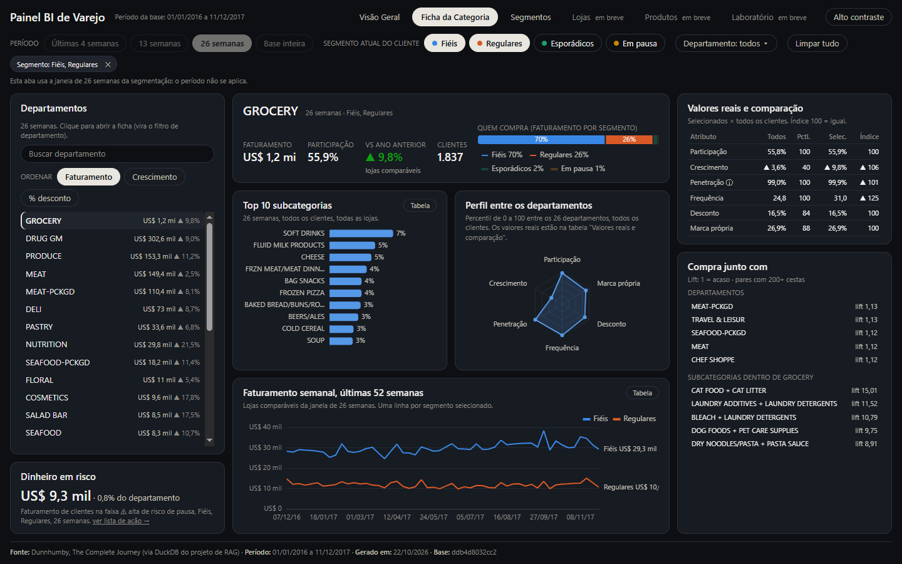
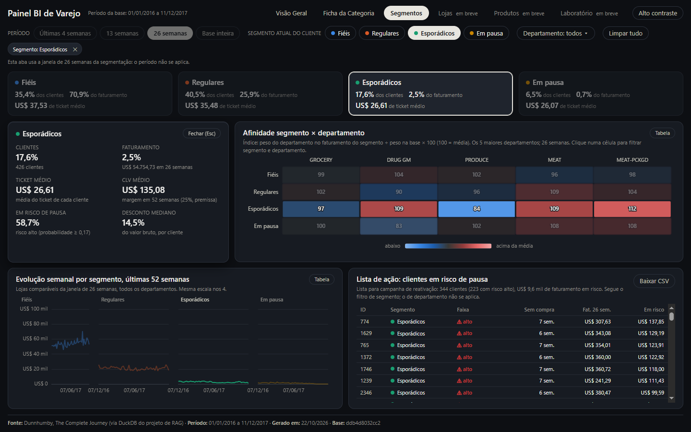

# Painel BI de Varejo (Dunnhumby)

**Abrir o painel:** https://caiosantosho2-dotcom.github.io/retail-bi-dashboard/

Painel de BI em uma página web, tema escuro, com abas: saúde do varejo, categorias (departamentos) e segmentos de
clientes, com filtros globais e clique que filtra, como no Power BI. É a continuação visual do projeto "Assistente
Comercial + Análise de Clientes" (projeto de RAG): painel e chat usam as mesmas definições e dão o mesmo número para a
mesma pergunta. As regras estão em [`docs/spec_dashboard.md`](docs/spec_dashboard.md).


## O que tem em cada aba

| Aba | Para quem | O que mostra |
|---|---|---|
| **Visão Geral** | diretoria e gerência | 6 KPIs com a variação contra o ano anterior nas lojas comparáveis (*like-for-like*), faturamento semanal das últimas 52 semanas com o período sombreado, mapa de calor dia × hora, departamentos (o clique filtra o painel) e as 3 conclusões das análises do chat |
| **Ficha da Categoria** | comercial e category management | cada departamento num radar de 6 atributos em percentil (participação, crescimento, penetração, frequência, desconto, marca própria) com os valores reais, quem compra, top 10 subcategorias, o que vai junto na cesta (*lift*), dinheiro em risco e a comparação dos segmentos selecionados com todos os clientes |
| **Segmentos** | CRM e marketing | Fiéis, Regulares, Esporádicos e Em pausa: a Roda, a matriz de afinidade segmento × departamento, a evolução semanal e a **lista de ação** de clientes em risco de pausa, com "Baixar CSV" para a campanha de reativação |

Filtros globais de período, segmento e departamento valem em todas as abas onde fazem sentido. Clicar numa barra,
célula ou fatia filtra o painel; Ctrl + clique soma; o segundo clique limpa.

| Ficha da Categoria | Segmentos | Celular |
|---|---|---|
|  |  |  |

## Rigor

Nenhum número é escrito à mão nem recalculado no navegador além de somas do que soma (faturamento, desconto).

- **Uma definição por métrica:** os números vêm das views do DuckDB do projeto de RAG; segmento e risco de pausa, do
  próprio código Python dele, importado só para leitura. Métricas novas do painel ficam em
  [`scripts/sql/views_painel.sql`](scripts/sql/views_painel.sql), cada uma com a definição e o grão.
- **Reconciliação:** [`scripts/reconciliar.py`](scripts/reconciliar.py) confere 328 números dos JSONs com SQL
  independente, direto na tabela fato e nas views do RAG (KPIs, cubos, 3 departamentos e 10 pares de cesta sorteados,
  afinidade, lista de ação) e contra o que o app de RAG mostra: Fiéis = 35% dos clientes e 71% do faturamento, AUC 0,85
  contra 0,74 da regra simples, 136 clientes em risco. Um teste de mutação mostra que ela pega erros plantados.
- **Contrato de dados:** cada JSON tem schema em [`contracts/`](contracts/), grão declarado e hash no `manifest.json`.
- **Tela:** cada fase foi aberta no navegador (Playwright) em 1440×900 e 390×844, com os critérios de aceite da spec
  conferidos um a um. Os relatórios ficam em [`docs/validacao/`](docs/validacao/).

## Rodar localmente

O site é estático e roda sozinho com os JSONs já exportados em `site/data/`, sem Python nem banco:

```
python -m http.server 8000 --directory site
```

e abra `http://localhost:8000` (não por `file://`: o `fetch` dos JSONs falha nele). A publicação no GitHub Pages é
feita pelo workflow [`.github/workflows/pages.yml`](.github/workflows/pages.yml) a cada mudança em `site/`.

## Regenerar os dados

**Exige o repositório do projeto de RAG.** Os números vêm do banco DuckDB dele e, para segmento, CLV e risco de pausa
por cliente, do código Python dele, importado só para leitura. O site publicado não precisa de nada disso.

1. Tenha o projeto de RAG com o banco construído (`data/processed/dunnhumby.duckdb`).
2. Copie `config.example.yaml` para `config.yaml` (fora do git) e preencha `duckdb_origem` e `rag_dir`.
3. Crie o ambiente com as mesmas versões do RAG: `python -m venv venv` e `venv\Scripts\pip install -r requirements.txt`.
4. Exporte, valide e reconcilie:

```
venv\Scripts\python scripts\exportar_dados.py           # todos os JSONs + manifest.json, uma etapa por processo
venv\Scripts\python scripts\exportar_dados.py --validar # schemas em contracts/, grão, orçamento e hash do manifest
venv\Scripts\python scripts\reconciliar.py              # cada número contra a origem e contra o app de RAG
```

A exportação e a reconciliação nunca escrevem no projeto de RAG: o banco abre em somente leitura, o import não gera
`__pycache__`, só são chamadas funções que não gravam log, e uma "foto" de todos os arquivos do RAG, tirada antes e
depois, interrompe a execução se algo mudar. O `manifest.json` registra o commit do RAG usado (`rag_commit`).

A exportação roda em etapas (`rag`, `base`, `cubos`, `kpis_filtrados`, `cesta_departamentos`, `cesta_subcategorias`,
`ficha_categoria`, `segmentos`, `manifest`), cada uma num processo novo, com o DuckDB limitado pelo `config.yaml`
(`memoria`: 1 GB e 2 threads). O pico medido é de cerca de 200 MB por etapa, e o total leva um minuto. Os resultados
intermediários ficam em `data/tmp/` (fora do git). `--etapa <nome>` roda uma só.

## O que a base não tem

- **Encarte e ponta de gôndola** (`causal_data`): existem na base, mas ficam para uma fase futura.
- **Share de gôndola e ruptura:** não existem na base Dunnhumby. O painel não mostra nem estima esses indicadores.
- **Calendário real:** as datas são inventadas, então os dias da semana aparecem como "Dia 1 … Dia 7".

## Dados

Base pública Dunnhumby, *The Complete Journey*: 2.500 domicílios, 2 anos de
compras. Os IDs de cliente da lista de ação são os pseudônimos da própria base; o painel não usa demografia.

## Próximas abas

Lojas (ficha da loja + Arena), Produtos (rede de cestas completa, marca própria, fabricante) e Laboratório (curva ROC
do modelo de risco, CLV por segmento, teste de desconto).
